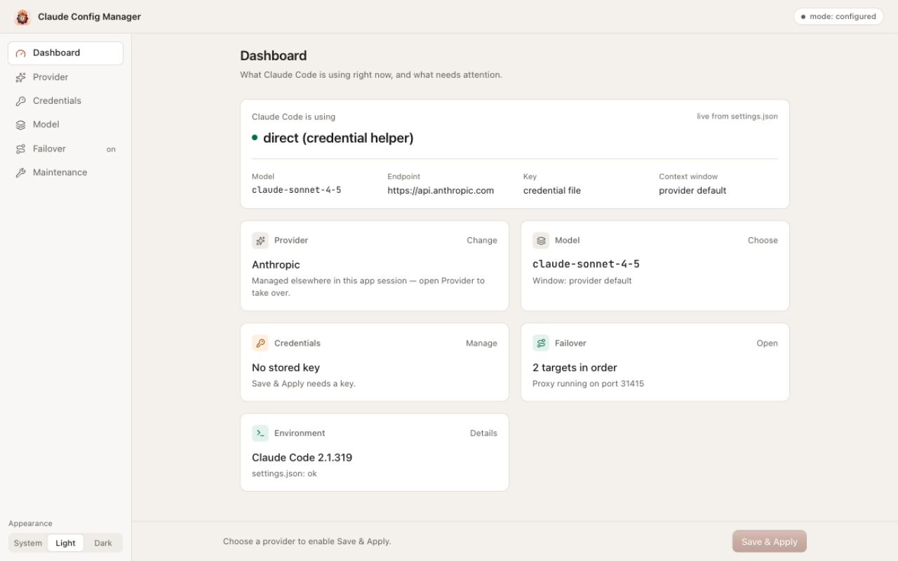
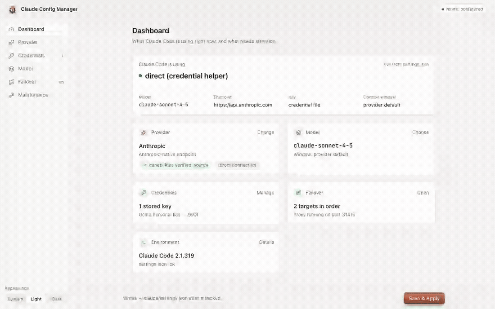
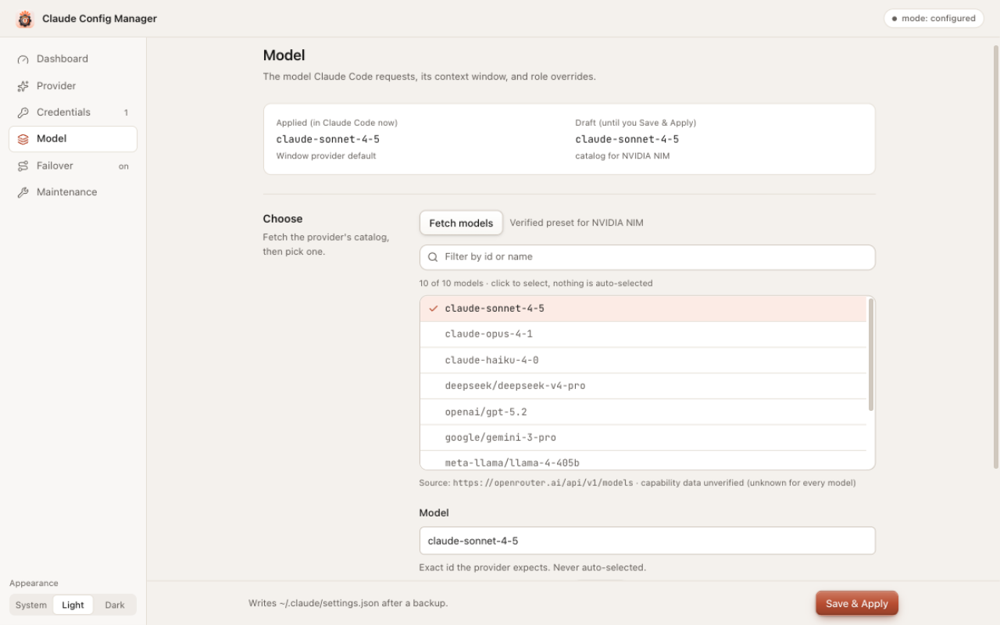
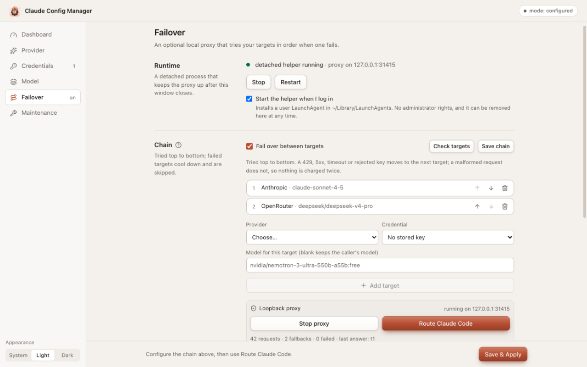
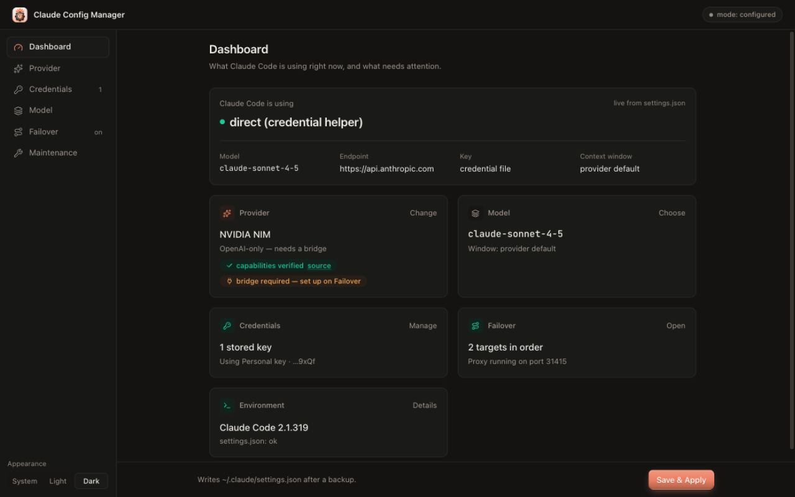

# Claude Config Manager

<p align="center">
  
</p>

A macOS desktop app that configures the **Claude Code CLI** without shell commands — pick a provider, store your key safely, choose a model with its real context window, and apply with a verified, reversible transaction.

Built with Tauri 2 · Rust · React · TypeScript · Tailwind CSS.

## Why this exists

Configuring Claude Code by hand means editing `~/.claude/settings.json` — remembering exact JSON keys, provider URLs, and environment variable names, with one typo silently breaking your setup. And if you route Claude Code at a custom model through a gateway, Claude Code silently holds unrecognized model IDs at a **200K-token context assumption**, even when the model supports 1M.

Claude Config Manager fixes all of that with a real UI and a safety contract:

| Without | With |
|---|---|
| Hand-edit JSON, hope it's valid | Transactional apply: **backup → atomic write → read-back verification → rollback** |
| Google the env-var names | Verified presets + a form that writes only keys it owns |
| Paste API keys into plaintext JSON anywhere | Keys stored as **owner-only files (0600)**, handed to the CLI via an `apiKeyHelper` script — never inside `settings.json`, never in logs |
| Unrecognized models silently capped at ~200K context | **One-click context-window adoption** from the provider's own published catalog |
| A crash or bad edit corrupts your config | A broken file is **never overwritten** — and every apply is reversible |

## Demo



The recording shows the full loop on a fixture backend: pick a provider → fetch its model catalog → select a model (nothing is ever auto-selected) → apply → the Dashboard reflects what Claude Code now uses, with the backup named.

## Screenshots

**Model selection** — searchable catalog, per-model declared context windows, applied-vs-draft comparison:

<p align="center">
  
</p>

**Failover** — an optional loopback-only proxy that tries your targets in order, with per-target health checks:

<p align="center">
  
</p>

**Dark mode**:

<p align="center">
  
</p>

## How it works

```
React UI  ──►  typed Tauri commands  ──►  Rust application service
                                              │
              ┌───────────────────────────────┼──────────────────────────────┐
              ▼                  ▼            ▼            ▼                 ▼
        ProviderCatalog   CredentialVault  ConfigWriter  ModelDiscovery  BridgeManager
```

- **ProviderCatalog** — versioned, compile-time-verified templates (endpoint, auth style, model-catalog endpoint, capability status). A template cannot smuggle an `http://` URL or an unverified capability claim.
- **CredentialVault** — owner-only credential files (`0600`) under `~/Library/Application Support/ClaudeConfigManager/secrets/`. `CLAUDE_CODE_MAX_CONTEXT_TOKENS`-style keys are written only after validation; keys never appear in settings, logs, or errors.
- **ConfigWriter** — refuses symlinks, refuses concurrent edits, refuses to overwrite a broken file, snapshots before writing, writes to a temp file, fsyncs, renames atomically, re-reads to verify, and rolls back on any mismatch.
- **ModelDiscovery** — fetches only documented catalog endpoints, caps payload size and entry count, and carries capability data verbatim (unknown stays unknown).
- **BridgeManager** — the optional translator for OpenAI-only providers: pinned version, sha512-verified download, dependencies from a committed lockfile, loopback-only binding, consent-gated execution, clean uninstall.

The application service orchestrates one transaction per apply — there is no path that writes settings.json without a backup and a verification step in front of it.

## Features

- Verified presets: **Anthropic, OpenRouter, DeepSeek, Z.AI, NVIDIA NIM** — plus custom Anthropic-compatible endpoints
- Model catalogs from documented endpoints, searchable, with per-model declared context windows — **never auto-selected**
- Multiple keys per provider with priority ordering (first enabled wins)
- Optional **failover proxy**: loopback-only, bearer-token-protected, tries targets in order, detached helper survives GUI closure
- Optional **bridge** for OpenAI-only providers: pinned `claude-code-router`, consent-gated, uninstalls cleanly
- Maintenance: environment checks, backups list, one-click reversible restore
- Light/dark/system themes, full keyboard navigation, screen-reader labels, reduced-motion support

## Install

1. Download `Claude.Config.Manager_1.0.0_aarch64.dmg` from the [releases page](https://github.com/SHAHID8142/claude-config-manager/releases/latest).
2. Verify it: `shasum -a 256 -c SHA256SUMS.txt`
3. Open the DMG and drag **Claude Config Manager** to **Applications**.
4. Launch — the build is unsigned, so Gatekeeper warns once: right-click → **Open** → **Open**, or:
   ```sh
   xattr -dr com.apple.quarantine "/Applications/Claude Config Manager.app"
   ```

## Build from source

```sh
npm install
npm run tauri dev      # develop
npm run tauri build    # .app + .dmg in src-tauri/target/release/bundle/
```

Requires Node ≥ 22 and Rust (stable). macOS Apple Silicon is the supported target; Linux/Windows builds are untested.

## Tests

530+ automated tests across both sides:

```sh
npm run check:frontend   # eslint + prettier + tsc + vitest
npm run check:rust       # fmt + clippy -D warnings + cargo test (13 suites)
```

Per-feature evidence lives in [`docs/audits/`](docs/audits/); the threat model in [`docs/security/`](docs/security/); design system in [`DESIGN.md`](DESIGN.md).

## Security model

- Keys: owner-only files, `0700` directory / `0600` file, replaced atomically — the helper script verifies permissions before every read and fails closed.
- Network: provider catalogs and the optional proxy/bridge bind **127.0.0.1 only**; the proxy requires a bearer token.
- No telemetry, no cloud, no background process without an explicit opt-in toggle.
- Supply chain: the bridge is version-pinned with a committed sha512 integrity check and a deterministic dependency lockfile; nothing downloads or executes before you consent.

## License

[MIT](LICENSE)
